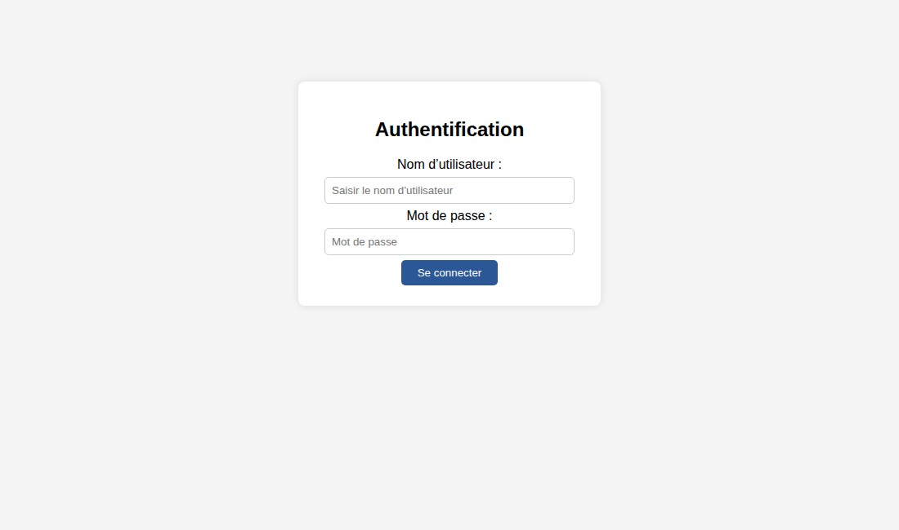
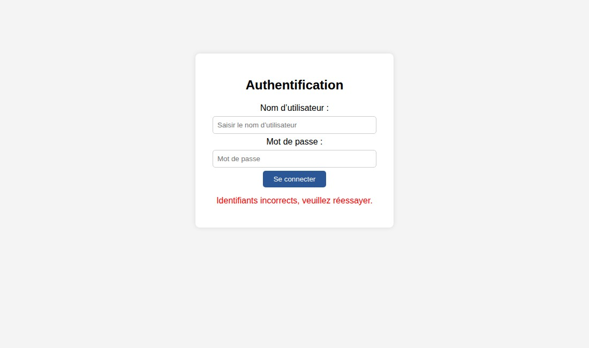
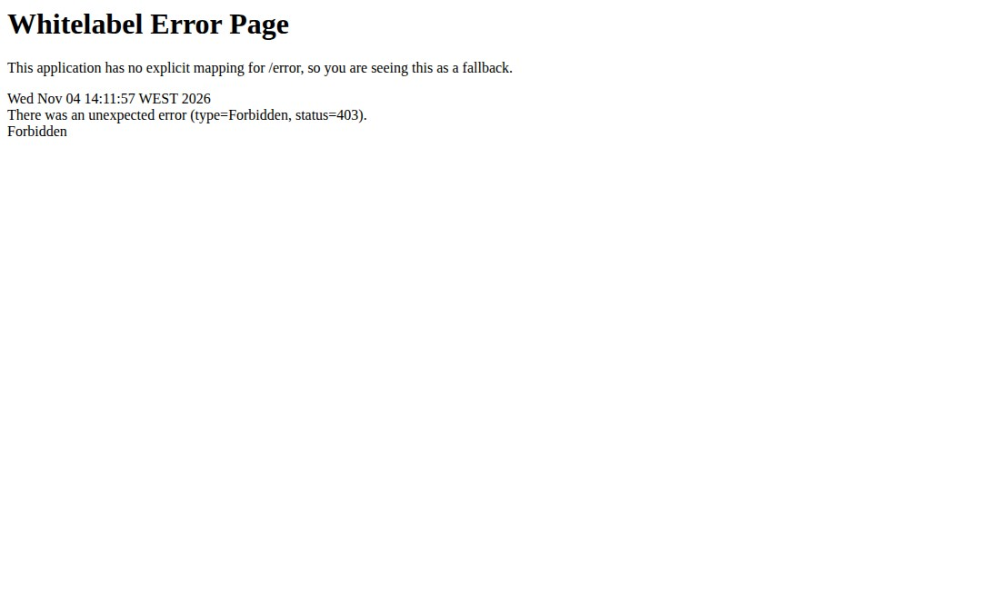
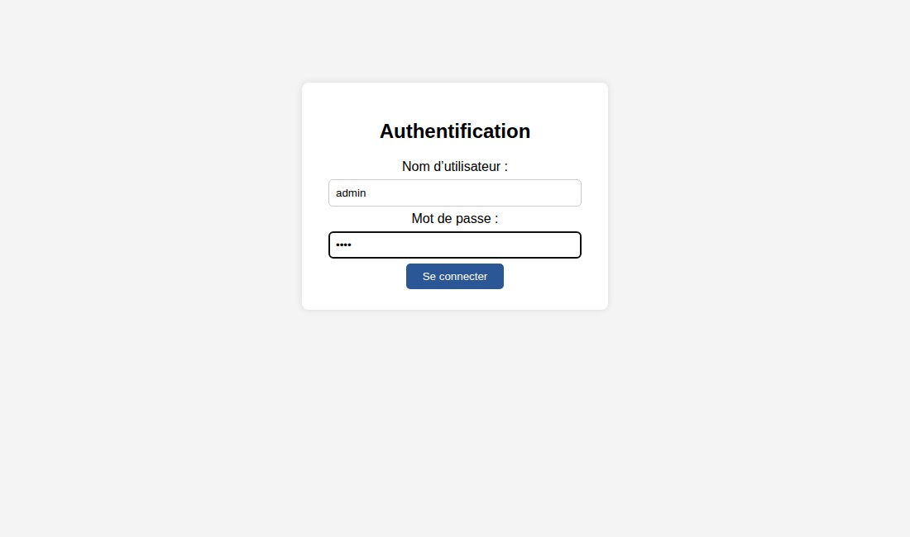
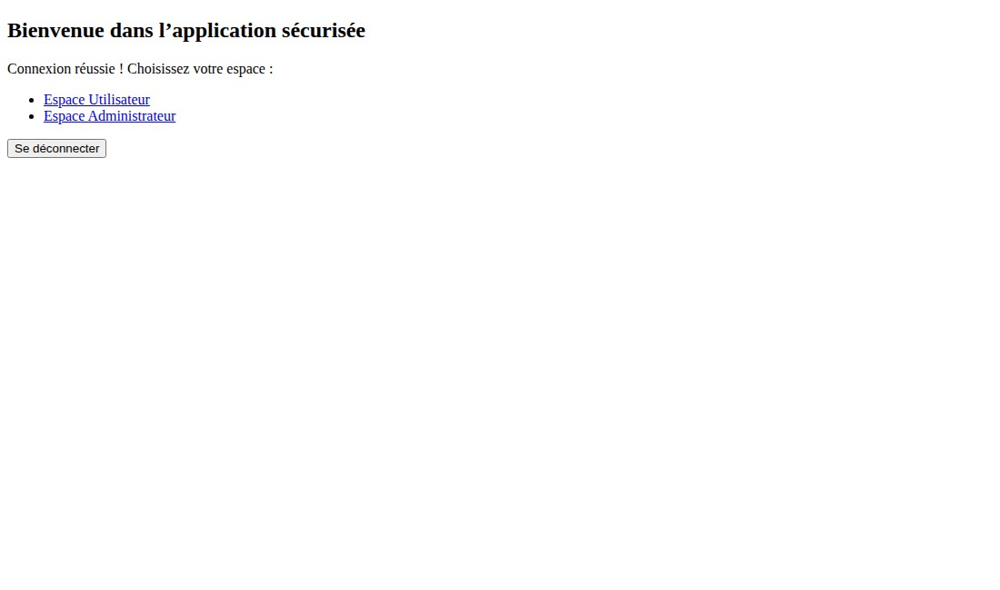
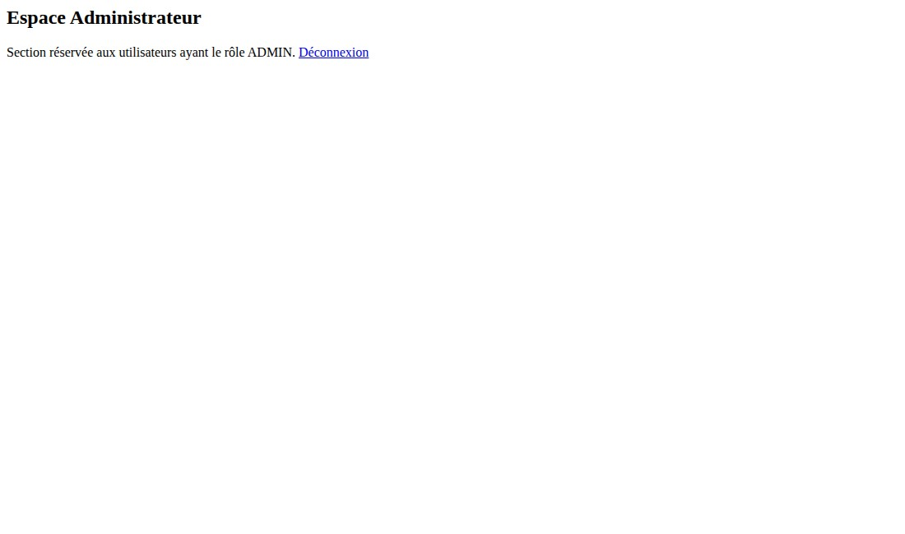
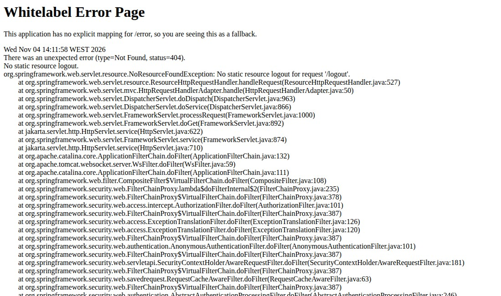
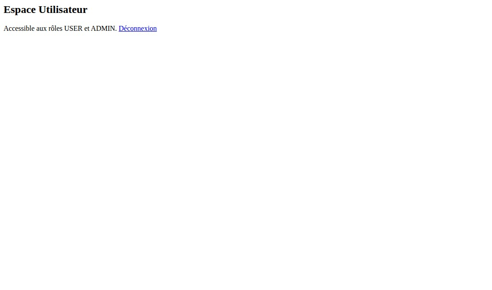

# TP10 — Formulaire de connexion personnalisé

Dans ce TP, nous avons personnalisé le formulaire de connexion et le flux d’authentification avec Spring Boot, Spring Security et Thymeleaf. Les comptes sont définis en mémoire. Spring Security vérifie les identifiants, gère les redirections et contrôle l’accès aux pages selon les rôles.

Lorsqu’un visiteur ouvre /user/dashboard sans être connecté, Spring Security le redirige vers /login. Le formulaire reprend le style fourni dans le TP.

Une tentative avec un mauvais mot de passe provoque une redirection vers /login?error=true. Le message Identifiants incorrects, veuillez réessayer. apparaît en rouge.

Nous saisissons ensuite les identifiants user / 1111. Le formulaire transmet les champs username et password par une requête POST vers /authenticate.

Après la connexion, la configuration defaultSuccessUrl("/home", true) redirige vers /home. Cette page propose les deux espaces et le bouton Se déconnecter.

Le compte user accède à /user/dashboard grâce à son rôle USER. La page affiche le texte et le lien Déconnexion fournis dans le TP.

Avec le même compte, une tentative d’accès à /admin/dashboard renvoie une erreur 403 Forbidden. Ce refus est attendu, car user ne possède pas le rôle ADMIN.

Le lien Déconnexion du tableau de bord envoie une requête GET vers /logout. Avec cette configuration, la requête renvoie une erreur 404 Not Found et la session reste active. Le lien a été conservé tel qu’il apparaît dans le support du TP.

En revenant sur /home, le bouton Se déconnecter envoie le formulaire POST prévu dans cette page avec le jeton CSRF. La déconnexion fonctionne et redirige vers /login?logout=true. Le message Vous êtes déconnecté avec succès. apparaît en vert. Après cette action, une page protégée redirige à nouveau vers /login.

Nous nous connectons avec admin / 1234. Ce compte possède le rôle ADMIN.

La connexion réussie redirige également admin vers /home, même si une autre page protégée avait été demandée avant la connexion.

Le compte admin accède à /admin/dashboard. La règle hasRole("ADMIN") réserve cette page aux administrateurs.

Le lien Déconnexion de l’espace administrateur utilise lui aussi GET /logout. Il produit la même erreur 404 et ne termine pas la session. Ce comportement a été observé pendant la vérification, et le code du lien est resté inchangé.

Le compte admin peut aussi ouvrir /user/dashboard. La règle hasAnyRole("USER", "ADMIN") permet l’accès à cette page avec l’un ou l’autre de ces rôles.

Depuis /home, le formulaire POST permet de déconnecter admin et d’afficher la confirmation. Une nouvelle tentative d’accès à /admin/dashboard redirige vers /login, ce qui confirme que la session est terminée. La déconnexion par le formulaire de l’accueil fonctionne pour les deux comptes ; les erreurs des liens GET des tableaux de bord restent présentes.
